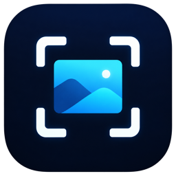

  

# Midnight Shot

[한국어](#한국어) · [English](#english)

## 한국어

### 참고할 화면을 띄워두고, 하던 일에 집중하세요

디자인 시안과 작업 화면을 비교할 때, 표의 숫자를 옮길 때, 설명을 보며 순서대로 따라 할 때. 필요한 내용을 보려고 창을 오가고 있나요?

Midnight Shot으로 필요한 부분을 캡처해 옆에 띄워두세요. 캡처가 다른 창 위에 남아 있어서, 참고할 내용을 보면서 작업을 이어갈 수 있어요.

[**Mac용 다운로드 · DMG**](https://github.com/midnightai-apps/midnightai-shot-releases/releases/download/macos-live-v1.0.2-b13/Midnight.Shot.Direct.dmg) · [변경 내용](https://github.com/midnightai-apps/midnightai-shot-releases/releases/tag/macos-live-v1.0.2-b13)

**macOS 14 이상 · Apple Silicon(M1 이상)**을 지원해요. 아래 기능과 사용 방법은 현재 배포 중인 Mac 버전 기준이에요.

### 필요한 부분만 골라서 캡처해요

작은 문구나 표만 필요하면 `Capture Area`로 영역을 드래그해보세요. 앱 창 하나는 `Capture Window`, 화면 전체는 `Capture Screen`으로 찍을 수 있어요. 메뉴 막대의 Midnight Shot 아이콘에서 선택하면 돼요.

캡처한 이미지는 화면에 바로 떠요. 설정에서 `Show screenshot overlay after capture`를 끄면 이미지를 화면에 띄우지 않고 파일로만 저장할 수도 있어요.

### 보기 편한 위치에 두고, 겹쳐서 비교해요

캡처 옆 도구 막대를 드래그해 원하는 위치로 옮기고, 창 크기를 조절해보세요. 핀 버튼으로 다른 창 위에 고정할 수 있어요. 원래 크기로 돌아가고 싶다면 이미지의 오른쪽 클릭 메뉴에서 `Restore Original Size`를 선택하세요.

디자인의 간격이나 배치를 맞춰볼 때는 캡처를 작업 화면 위에 겹쳐보세요. 도구 막대에서 투명도를 낮추면 뒤쪽 화면이 함께 보여서 차이를 확인하기 편해요.

### 여러 자료를 펼쳐두고 함께 봐요

이전 캡처도 계속 보고 싶다면 `Preferences…`의 `When capturing again`에서 `Keep every overlay`를 선택하세요. 새로 찍을 때마다 이미지가 추가돼서 서로 다른 화면을 나란히 볼 수 있어요. `Replace previous overlay`를 선택하면 가장 최근 캡처만 남아요.

여러 캡처를 함께 옮기려면 `Command` 키를 누른 채 각 이미지의 도구 막대를 클릭해 선택하세요. 선택한 캡처들을 함께 드래그하거나 투명도를 한 번에 바꿀 수 있어요. 메뉴의 `Show Only Selected`로 선택한 이미지에만 집중할 수도 있어요.

### 필요한 부분만 잘라서 복사하거나 저장해요

도구 막대의 자르기 버튼으로 캡처에서 보여줄 범위를 조절해보세요. 복사 버튼을 누르면 현재 보이는 부분을 문서나 메신저에 붙여넣을 수 있어요. 저장 버튼으로는 같은 부분을 PNG 파일로 따로 저장해요.

자르기와 화면 크기 조절은 처음 저장한 캡처 파일을 바꾸지 않아요. 전체 이미지를 다시 보고 싶으면 오른쪽 클릭 메뉴에서 `Restore Full Area`, 전체 원본을 복사하려면 `Copy Full Original`을 선택하세요. 따로 저장할 때는 원본과 다른 파일 이름을 써주세요.

### 같은 위치를 다시 찍을 때, 영역을 새로 고르지 않아도 돼요

영역 캡처 이미지에서 오른쪽 클릭한 뒤 `Recapture Original Area`를 선택하세요. 처음 골랐던 화면 위치를 다시 캡처해서 그 이미지 창의 내용을 바꿔요. 같은 화면에서 문구나 배치를 수정하며 확인할 때 편해요.

이 기능은 영역 캡처에서 사용할 수 있어요. 모니터 연결이나 해상도가 달라져 같은 위치를 확인할 수 없으면 영역을 다시 선택하도록 안내해요.

### 캡처 파일은 내 컴퓨터에 모아둬요

캡처는 지정한 저장 폴더 아래에 날짜별 PNG 파일로 남아요. `Preferences…`의 `Save to`에서 저장 위치를 확인하고 `Choose Folder…`로 바꿀 수 있어요. 캡처 도구 막대의 폴더 버튼을 누르면 Finder에서 해당 파일을 찾아줘요.

화면의 캡처 창을 닫아도 저장한 PNG 파일은 남아요. 필요한 자료는 나중에 저장 폴더에서 다시 꺼내 쓰세요.

### 설치하고 첫 캡처를 찍어보세요

1. 위 다운로드 링크에서 DMG를 받아 열어요.
2. **Midnight Shot Direct**를 **Applications(응용 프로그램)** 폴더로 드래그한 뒤 실행해요.
3. macOS에서 요청하는 **화면 기록 권한**을 허용해주세요. 권한이 없으면 화면을 캡처할 수 없어요.
4. 메뉴 막대의 Midnight Shot 아이콘에서 `Capture Area`를 누르고 원하는 영역을 드래그해요.

새 버전은 메뉴의 **업데이트 확인…**에서 확인할 수 있어요. **업데이트 설정…**의 **자동으로 업데이트 확인**을 켜면 앱이 새 버전이 있는지 확인해요. Mac App Store에서 설치한 버전은 App Store에서 업데이트해요.

일반 설치에는 DMG를 받으세요. 릴리즈에 함께 있는 ZIP은 앱 내 업데이트용 파일이에요. Windows 배포 파일은 아직 이 저장소에 올라와 있지 않아요. 배포 현황은 [Releases](https://github.com/midnightai-apps/midnightai-shot-releases/releases)에서 확인할 수 있어요.

---

## English

### Keep your reference in view while you work

Comparing a design with your work? Moving numbers from a table? Following instructions step by step? Switching windows to check a detail can interrupt what you're doing.

Capture the part you need with Midnight Shot and keep it beside your work. Your screenshot stays above other windows, so you can refer to it as you go.

[**Download for Mac · DMG**](https://github.com/midnightai-apps/midnightai-shot-releases/releases/download/macos-live-v1.0.2-b13/Midnight.Shot.Direct.dmg) · [What's new](https://github.com/midnightai-apps/midnightai-shot-releases/releases/tag/macos-live-v1.0.2-b13)

Requires **macOS 14 or later and Apple Silicon (M1 or later)**. The features and instructions below describe the Mac version currently available here.

### Capture just the part you need

Choose `Capture Area` and drag over a piece of text or a table. Use `Capture Window` for a single app window, or `Capture Screen` for the whole screen. You'll find all three in the Midnight Shot menu bar menu.

Your capture appears on screen right away. If you only want to save a file, turn off `Show screenshot overlay after capture` in Preferences.

### Put it where it helps, then look through it to compare

Drag the toolbar beside a screenshot to move it, and resize the window to fit your workspace. Use the pin button to keep it above other windows. To return to its original size, right-click the image and choose `Restore Original Size`.

Place a screenshot over the screen you're working on and lower its opacity from the toolbar. Seeing both at once helps you compare spacing and layout.

### Keep several references in view

In `Preferences…`, set `When capturing again` to `Keep every overlay` to keep earlier captures visible. Each new capture adds another image, so you can compare them side by side. Choose `Replace previous overlay` if you prefer to keep only the latest one.

Hold `Command` and click each screenshot's toolbar to select several captures. You can drag them together or change their opacity as a group. Choose `Show Only Selected` from the menu to focus on just those images.

### Crop what you need, then copy or save it

Use the crop button to adjust the visible area. The copy button puts that area on the clipboard, ready to paste into a document or message. The save button exports it as a separate PNG.

Cropping and resizing the on-screen image leave the original capture file unchanged. Right-click and choose `Restore Full Area` to see the whole image again, or `Copy Full Original` to copy it. Use a different filename when exporting to keep the original capture.

### Capture the same spot again

Right-click a region capture and choose `Recapture Original Area`. Midnight Shot captures the location you first selected and replaces the image in that window. Use it while adjusting text or a layout in the same part of your screen.

This option is available for region captures. If a display or resolution change prevents the app from confirming the original location, it asks you to select an area again.

### Find your captures on your computer

Captures are saved as PNG files in date folders inside your chosen save folder. Check the location under `Save to` in `Preferences…`, or use `Choose Folder…` to change it. The folder button beside a screenshot reveals its file in Finder.

Closing a screenshot window leaves the saved PNG in place. Open the save folder when you need it again.

### Install and take your first capture

1. Download and open the DMG linked above.
2. Drag **Midnight Shot Direct** into **Applications**, then launch it.
3. Allow **Screen Recording** when macOS asks. The app needs this permission to capture your screen.
4. Click the Midnight Shot icon in the menu bar, choose `Capture Area`, and drag over a region.

Choose **업데이트 확인…** (Check for Updates) from the menu to check for a new version. In **업데이트 설정…** (Update Settings), turn on **자동으로 업데이트 확인** to enable automatic checks. If you installed the Mac App Store version, update it through the App Store.

Use the DMG for a normal installation. The ZIP included with the release is for in-app updates. Windows downloads aren't available in this repository yet. Check [Releases](https://github.com/midnightai-apps/midnightai-shot-releases/releases) for available downloads.
